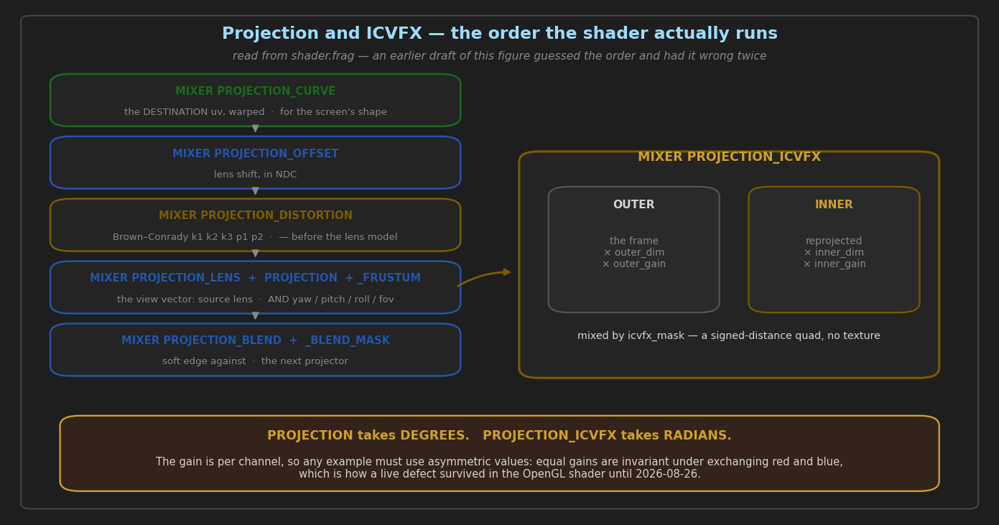

# Projection and ICVFX

> **State:** partial — the geometry and blend commands are shipped and measured; ICVFX is shipped
> with only its per-channel gain measured
> **Modules:** `src/accelerator/ogl/image/shader.frag`, `src/accelerator/vulkan/image/fragment_shader.frag`, `src/core/frame/frame_transform.h`
> **Commands:** 13 fork-specific AMCP commands (10 `PROJECTION_*`, 2 ICVFX, and `MIXER FLIP`)
> **Architecture:** none, deliberately — the shader stage order is the one structural fact, and §below carries it with a diagram generated from the shader
> **Guide:** [`../guides/VIRTUAL_PRODUCTION_FEATURES.md`](../guides/VIRTUAL_PRODUCTION_FEATURES.md), [`../guides/PROJECTION_CALIBRATION.md`](../guides/PROJECTION_CALIBRATION.md)
> **Coverage:** `geometry`, `blend-mask`, `calibration`, `venue-test`, `icvfx-parity`

Warps a layer onto a non-planar screen — a cylinder, a dome, a fisheye — soft-edge blends it
against neighbouring projectors, and applies the in-camera VFX inner/outer frustum treatment used
on LED volumes. All of it is per **layer**, composed on the layer's `image_transform`, so two
layers on one channel can carry different geometry.

**Read §4 before trusting any of it.** Twelve of these thirteen commands had no documentation at
all until 2026-08-26, and the thirteenth carried a red/blue exchange on the OpenGL mixer that no
test could see.

---

## 1. What is implemented today

Every row verified against `src/protocol/amcp/AMCPCommandsImpl.cpp` at the line given, not from
another document.

| command | parameters |
| :--- | :--- |
| `MIXER PROJECTION` | `yaw pitch roll fov [dur] [tween]` — degrees, converted by `DEG2RAD` |
| `MIXER PROJECTION_OFFSET` | `offset_x offset_y [dur] [tween]` |
| `MIXER PROJECTION_CURVE` | `CYLINDER\|SPHERE\|FISHEYE arc_deg [arc_v_deg] [eye_distance] [dur] [tween]` |
| `MIXER PROJECTION_LENS` | `CYLINDER\|SPHERE\|FISHEYE` — the *source* lens |
| `MIXER PROJECTION_ICVFX` | `enable [inner_fov_deg] [feather] [outer_dim] [inner_dim] [dur] [tween]` — `enable` takes `1\|0\|ON\|OFF\|TRUE\|FALSE\|YES\|NO`, and anything else is `400` |
| `MIXER PROJECTION_ICVFX_COLOR` | `ir ig ib or og ob [dur] [tween]` |
| `MIXER PROJECTION_FRUSTUM` | `frustum_h frustum_v [dur] [tween]` |
| `MIXER PROJECTION_DISTORTION` | `k1 k2 k3 [p1 p2] [dur] [tween]` — Brown–Conrady |
| `MIXER PROJECTION_BLEND` | `left right [top] [bottom] [gamma] [dur] [tween]` |
| `MIXER PROJECTION_BLEND_MASK` | `<png path>` \| `NONE` \| *(empty = query)* |
| `MIXER FLIP` | `H` \| `V` \| `HV` \| `NONE` \| *(empty = query)* |

All eleven are registered **consecutively in one block** in `AMCPCommandsImpl.cpp` — search for
`L"MIXER PROJECTION"`; `MIXER FLIP` follows two lines later.

> **The line numbers this table used to carry had all drifted by exactly +65**, and `FLIP`'s pointed
> at its handler rather than its registration. Eleven numbers that move together on any insertion
> above them are eleven things to get wrong at once, so they are gone rather than updated — see the
> root `CLAUDE.md` on citing a symbol instead of a line.

**Three details that surprise people, all verified:**

- **The mask geometry and the feather are measured since 2026-09-19** — `icvfx-mask` in the
  harness, both mixers. With no auto-projection driving it the quad sits at the raster's four
  corners, so `icvfx_mask` reduces to the distance to the unit square over the feather and the
  inner plateau's half-extent is **(W/2)(1 - feather) across and (H/2)(1 - feather) down**. That
  is a prediction in pixels from a parameter in NDC, checked at three feathers. **The feather is
  in output NDC and therefore anisotropic in pixels** — at 16:9 the horizontal ramp is 16/9 of
  the vertical, which the battery asserts, because making it isotropic looks like a fix and would
  pass any check that measured one axis.
- **The quad a REAL CAMERA drives is measured too**, on the wall's own raster. With
  `PREVIZ AUTOPROJECTION` on, `compute_frustum` recomputes `icvfx_q` from the production camera's
  pose on every move and writes it onto the mapped channel's layer, so the inner region appears in
  the wall's picture — which is a different picture from previz's viewport. The prediction is
  trigonometry: a camera square on at distance `d` with vertical fov `f` gives quad half-extents
  `d*tan(f/2)*(16/9) / (width/2)` and `d*tan(f/2) / (height/2)` in the wall's NDC. Checked at
  three poses, because a dolly changes the region's SIZE and a truck changes its POSITION, and a
  projection can get one right and the other wrong.

  **`PREVIZ AUTOPROJECTION` with no `SOURCE` applies to LAYER 0**, which its own comment calls
  legacy mode. Content on any other layer is simply not projected — and that looks exactly like
  auto-projection doing nothing.
- **Both commands TWEEN**, and both are measured since 2026-09-19. `[dur] [tween]` interpolates
  every ICVFX field that sensibly can — the dims, the feather, and all six gain components —
  through `frame_transform::tween_to`. The mask QUAD deliberately does not tween: it snaps to its
  destination, because previz recomputes it per frame and interpolating towards a value that has
  already moved on would lag the camera.
- **The 360 inner-frustum REPROJECTION is measured** — the parallax correction the feature is
  named after. With `MIXER PROJECTION` on, the outer region samples the panorama through the
  wall's own view direction and the inner region through `inner_yaw/pitch/roll/fov`, so the wall
  shows the environment from where the WALL is and the camera's frustum from where the CAMERA is.
  The check needs no model of the equirect mapping: the inner region at `inner_yaw = Y` must show
  what the whole frame shows at `view_yaw = Y`, and the outer region must not move while the
  inner one sweeps.

  **`MIXER PROJECTION` takes `<yaw> <pitch> <roll> <fov>` with no enable flag** — `enable` is
  `fov > 0`. A spare `1` in front shifts every argument, leaves `fov` at 0 and turns projection
  off, and the flat picture that results looks plausible while every inner-frustum parameter
  appears inert.
- **The inner frustum's ORIENTATION is measured under one oracle.** `inner_pitch`, `inner_roll`,
  `inner_offset_x` and `inner_offset_y` each have an outer twin — `proj_pitch`, `proj_roll`,
  `proj_offset_x`, `proj_offset_y` — that moves the WHOLE frame the same way. So the check is
  always the same shape: with the inner parameter at V and the view at rest, the inner region must
  equal the same region of a frame taken with the outer twin at V. It matches byte for byte, and
  neither side needs the equirect mapping modelled.

  **And the rest of the PROJECTION family is measured since 2026-09-20** — `projection` in the
  harness, 16/16 on both mixers. The soft-edge blend against `alpha == PROD clamp(d/width,0,1)
  ** gamma` at 0.56 code values; the radial distortion as the zoom it is equivalent to on one
  circle, `fov' = 2 atan(radial(r0) tan(fov/2))`; the tangential terms separated by the axis each
  moves, `(3p2x^2, p1x^2)` on the horizontal centre line, and then by their magnitude; and
  `frustum_h` shown to be the exact negative of `offset_x`. **Note where the blend lands:** the
  mixer output is premultiplied, so the blend multiplies ALPHA as well as colour, and a consumer
  that discards alpha discards the blend with it. `source_lens` and `screen_arc_v` are still
  driven by nothing.

  `inner_eye_distance` has a twin too — `eye_distance`, in the CURVE block rather than the
  projection one — and it is checked the same way, on a 90 degree cylinder because on a flat
  screen neither does anything. **It reached no shader at all until 2026-09-20**: present in the
  transform, the registry, the tween and both composition allowlists since 2026-06-21, and
  uploaded by neither kernel. `apply_curve_warp` took its `k` from the single `eye_distance`
  uniform, so there was nowhere for the camera's own eye to go.
- **A typo used to turn ICVFX OFF.** `enable` was `at(0) == "1" || iequals "true"`, so every other
  word — `BANANA`, and `YES` — disabled the inner frustum and answered `202`. On a live volume
  that is the inner frustum vanishing because a word was misspelled. **Fixed 2026-09-19**: it goes
  through the same `parse_on_off` as the eight other boolean arguments in this server, and a word
  that names neither answer is `400`. The signature row above ALSO said `inner_fov_rad` while the
  note below it said degrees, which had been true since 2026-09-15.
- ~~**`PROJECTION` takes degrees, `PROJECTION_ICVFX` takes radians.**~~ **BOTH TAKE DEGREES since
  2026-09-15.** `PROJECTION_ICVFX`'s `inner_fov` is now multiplied by `DEG2RAD` at parse, exactly
  where `PROJECTION` does it and where auto-projection already did (`inner_fov_deg * I2R`). The
  argument is `inner_fov_deg` in the grammar now, and a value outside 0..180 is refused.

  **The transform and the field registry keep RADIANS, deliberately** — that is what the shader
  wants, and every projection field is labelled `"rad"` (`proj_yaw`, `proj_fov`,
  `proj_inner_fov`). The conversion belongs at the operator boundary, which is the only place it
  was missing.
- **`PROJECTION_CURVE` and `PROJECTION_LENS` are different things.** `CURVE` is the shape of the
  *screen* you are projecting onto; `LENS` is the projection the *source material* was shot or
  rendered with. Both take the same three keywords, which is why they get confused.
- **`PROJECTION_BLEND_MASK` with no parameters is a query**, and with `NONE` clears. Only a path
  sets a mask.
- **`MIXER FLIP` is documented here rather than with the grading commands** because it is a
  geometry operation on the layer's transform (`flip_h` / `flip_v`), and the ICVFX branch of both
  shaders reads those same flags when reprojecting the inner frustum. Empty is a query returning
  `H`, `V`, `HV` or nothing; `NONE` clears. It was the last of the fork's 91 AMCP commands with no
  documentation anywhere.

---

## 2. How to drive it

A 180° cylinder with a soft left edge, a lens-distortion correction, and asymmetric ICVFX gain:

```
PLAY 1-1 "clip.mov"
MIXER 1-1 PROJECTION_CURVE CYLINDER 180 0 1.0
MIXER 1-1 PROJECTION 0 0 0 90
MIXER 1-1 PROJECTION_BLEND 0.15 0 0 0 2.2
MIXER 1-1 PROJECTION_DISTORTION -0.12 0.03 0
MIXER 1-1 PROJECTION_ICVFX 1 0.5 0.1 0.6 1.0
MIXER 1-1 PROJECTION_ICVFX_COLOR 0.3 1.0 0.7 1.0 0.6 0.25
```

Query the current mask, then clear it:

```
MIXER 1-1 PROJECTION_BLEND_MASK
MIXER 1-1 PROJECTION_BLEND_MASK NONE
```

**The gains in that example are deliberately asymmetric — `1.0 0.6 0.25`, three distinct values.**
Copy that shape, not an equal-gain example. Equal per-channel gains are invariant under exchanging
red and blue, so a white balance written as `1.0 1.0 1.0` demonstrates nothing and cannot be
turned into a test that discriminates. That is not a hypothetical: see §4.

No `<configuration>` elements — this feature is entirely runtime, per layer.

---

## 3. Design decisions, and what they cost

**Per-channel uniforms are swizzled at the call site, not reversed on upload.** The OpenGL mixer
carries the pixel in **BGR** through the whole grading chain, so `col.r` holds blue. Every
per-channel `vec3` in `shader.frag` therefore takes `.bgr` where it is used — `lmg_*`, `cdl_*`,
`gc_limit`, `luma_coeff`. The exception is `split_*_color`, which is reversed on upload instead
(`sc[2], sc[1], sc[0]` in `image_kernel.cpp`). Both are correct; the mixture is the hazard, because
a new uniform can look consistent with either convention while doing neither.

**Vulkan grades in RGB and needs no swizzle**, which is why a defect of this class shows up as a
mixer *divergence* rather than as a wrong picture on both — and why `icvfx-parity` compares the
two mixers rather than modelling the expected colour.

**The mask is a signed-distance quad, not a texture.** `icvfx_mask` computes the winding of the
four `icvfx_q*` corners and takes the minimum edge distance, so the inner frustum follows a
projective quad without an upload. The cost is that the mask depends on a default quad this
feature's own battery does not set — which is why `icvfx-parity` compares mixers instead of
asserting an absolute colour.

---

## 4. Verification — what is measured, and what is not

| what | battery | numbers | date |
| :--- | :--- | :--- | :--- |
| ICVFX per-channel gain, both mixers | `icvfx-parity` | worst **0 LSB**, mean 0.000, 0.00 % of samples | 2026-08-26 |
| …with the OpenGL swizzles removed (positive control) | `icvfx-parity` | worst **144 LSB**, mean 28.8, 66.4 %, exit 1 | 2026-08-26 |
| geometry and rasters | `geometry` | — | — |
| blend mask reaching the shader | `blend-mask` | — | — |

**What these numbers do NOT cover, which is most of the feature.** `icvfx-parity` sets the gain
and nothing else. It does not cover the mask geometry, the feather, the inner-frustum
reprojection, `inner_yaw/pitch/roll`, the tweened form of either ICVFX command, or any of the ten
`PROJECTION_*` commands beyond what `geometry` and `blend-mask` already did. A green
`icvfx-parity` means *the per-channel gain agrees between mixers* — nothing more.

**The defect this coverage exists because of.** `icvfx_inner_gain` and `icvfx_outer_gain` were
uploaded in RGB order and applied straight to a BGR pixel, so on the OpenGL mixer the red gain
multiplied blue and the blue gain multiplied red. Vulkan was always correct. It survived because
**nothing in the harness drove ICVFX at all**, and because a white balance is naturally set with
equal gains — which are invariant under exactly that exchange. The obvious way to exercise the
feature was the one way that could not see the defect.

The positive control above is the reason to trust the fix: with the two `.bgr` swizzles removed
the battery fails at 144 LSB, and **green comes back bit-identical** — 0.00 mean, 0 worst, 0.0 %
of samples — which is the fingerprint of a red/blue exchange and of almost nothing else.

---

## 5. Known gaps

1. **The mask, feather and inner-frustum reprojection are unmeasured.** Closing it needs a
   geometric fixture — a known quad and a known feather with a predicted coverage — not another
   colour comparison.
2. **No tweened-form coverage** for any of the twelve commands. `duration`/`tween` are accepted
   and untested throughout the fork, not only here.
3. ~~**The degrees/radians inconsistency.**~~ **FIXED 2026-09-15 by changing the unit**, which
   was possible because nothing consumes this command yet — the shape is chosen on merit rather
   than on compatibility. **It IS a breaking change** for any show file that passed radians; the
   CHANGELOG says so plainly.

   An earlier pass the same day guarded the symptom instead — refusing a value above π on the
   grounds that no field of view can exceed 180° — which was the right fix while back-compat was
   assumed and the wrong one once it was not. Recorded because the difference was a question
   about the deployment, not about the code.

4. ~~**`PROJECTION_LENS` accepts only three keywords.**~~ **FIXED 2026-09-15, and this entry
   understated it.** It did not keep the previous value: `screen_curve_type lens =
   screen_curve_type::flat` is the initialiser, so an unrecognised keyword silently selected
   **RECTILINEAR**. `PROJECTION_CURVE` had the identical shape and was worse — its initialiser is
   `flat` too, so `PROJECTION_CURVE SPEHRE 90` **flattened a curved screen** and answered `202`.

   Both now name all four values and refuse anything else with a `400`; `RECTILINEAR` and
   `FLAT`/`NONE` are spelled out rather than being whatever is left over, which is exactly what
   made the typo invisible. `MIXER FLIP` was swept in the same pass — its own comment read
   *"else NONE / 0 / anything unrecognised -> both false"*, so `FLIP HH` quietly un-flipped a
   mirrored output — as was `MIXER SHAPE`, whose option loop skipped an unknown keyword **and** a
   known one whose value had been left off.

---

## 6. Related commits

| commit | why it matters |
| :--- | :--- |
| `b1da34a34` | the ICVFX red/blue fix, with three other audit findings — and the reasoning for why an audit found it where testing could not |
| `d2f6fc4` *(harness)* | `icvfx-parity`, including the positive control and why asymmetric gains are the design rather than a detail |
| `e8e4f244d` | the rule that a per-channel colour value must be tested asymmetrically, recorded where someone picking a battery will meet it |

Earlier projection work predates this document; `PROJECTION_BLEND_MASK`'s own history is worth
reading for a related trap — the command returned `202` and rendered byte-identically to no mask
at all on both backends, because the field was missing from the transform allowlist. Fixing that
then exposed a second defect underneath it: `col.rgb *= texture(...).rgb` on a shader carrying BGR.
Same class as the gain defect above, found the same way.

---

## 7. Diagrams



Generated by `docs/diagrams/generate_feature_diagrams.py`.

**The order in that figure is read from `shader.frag`, not inferred** — and an earlier draft of it
got the order wrong twice, which is worth recording because it is the same failure this whole
folder is built against. The draft drew `LENS` first and `DISTORTION` after `PROJECTION`. The
shader does neither:

```
base_uv                                                     TexCoord.st / TexCoord.q
view_uv = is_curved ? apply_curve_warp(base_uv) : base_uv    <- CURVE, on the DESTINATION, first
uv      = is_360    ? get_equirect_uv(view_uv)  : view_uv

  inside get_equirect_uv_ex:
    1.  screen uv -> NDC
    1a. ndc -= (off_x, off_y)                                <- _OFFSET
    1b. Brown-Conrady radial k1/k2/k3                        <- _DISTORTION, BEFORE the lens model
    1c. Brown-Conrady tangential p1/p2
    2.  view vector from source_lens AND yaw/pitch/roll/fov   <- _LENS and PROJECTION, together
```

The shader's own comment gives the reason `CURVE` comes first: *"destination curve compensation is
orthogonal to the source projection"*. `_LENS` and `PROJECTION` are one step, not two, because both
feed the same view-vector construction — which is also why they are drawn in one box.
